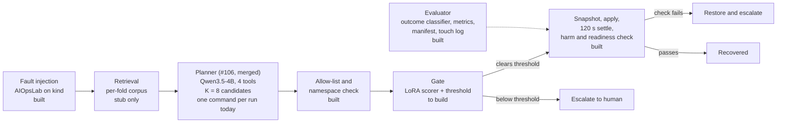
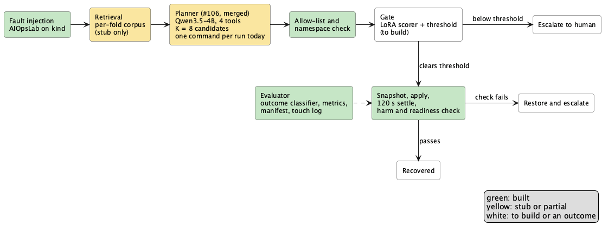
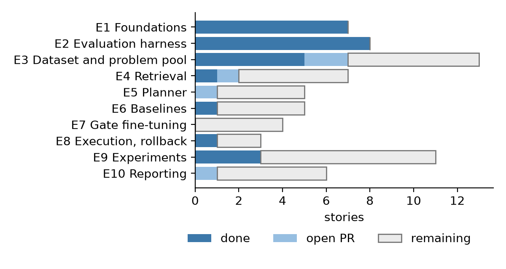
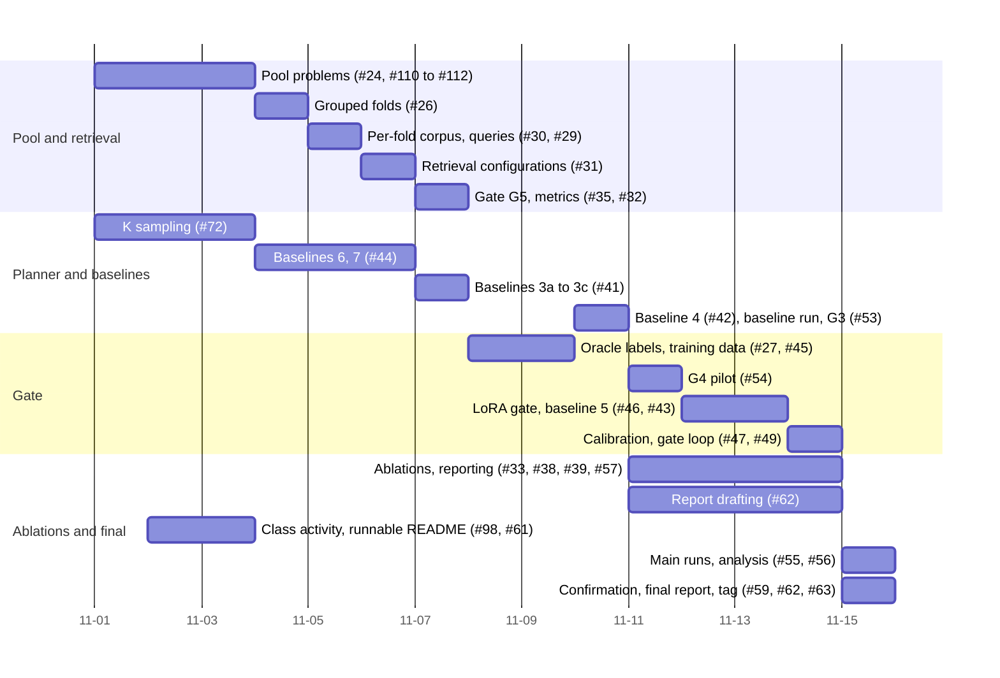
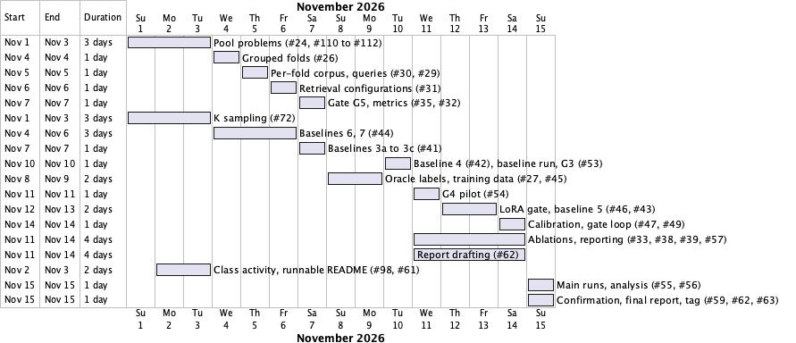

# Mid-submission report: a validity gate for Kubernetes incident remediation

Course CL3410, Language Models and Agents, Monsoon 2026. Status as of 2026-10-30. Final submission: 2026-11-15.

Authors: Abhinav Borah, Dhawal Pawanarkar, Gargi Saini, Vivek Dhayal M K.

**Code:** https://github.com/abhinavborah/k8s-RemValGate

**Project board:** https://github.com/users/abhinavborah/projects/3

## Abstract

LLM agents often name the cause of a microservice incident correctly and then pick a fix that does not restore the service. We test whether a small fine-tuned gate (Qwen3.5-4B with LoRA) picks working commands among candidates better than the planner's own ranking. By 2026-10-30 we have built the evaluation harness with automatic rollback, an AIOpsLab overlay with authored and validated problems, a sealed confirmation slice, run manifests with an evaluation-set touch log, and a planner with four tools. A timing pilot measured 144.8 s per rollout. The remaining work is retrieval, candidate sampling and the gate; section 10 gives the plan with its cuts.

## 1. Introduction

On the AIOpsLab mitigation task the best agent in the AIOpsLab paper reaches 54.55 percent accuracy. R2Act reports 91.4 to 99.7 percent root-cause accuracy and 36.8 to 60.3 percent recovery validity. These are cited figures, not ours.

Research question: does a small gate trained with LoRA select working candidate commands better than the planner's own ranking? We measure candidate-level AUROC, Brier score and top-1 accuracy with incident-clustered intervals.

Capabilities and why we use them:

- Fine-tuning: the gate must learn which candidates work. We compare it with the untuned planner and with a planner ranked by log-probability.
- Retrieval: grounds the planner in earlier incidents and runbook entries. Four configurations are compared: none, dense, dense with a cross-encoder reranker, hybrid with a reranker.
- Tool calling: the planner reads live cluster state through four tools.

## 2. System

 (source: `figures/system.puml`)

## 3. Progress

26 of 69 stories are done and 5 more have an open draft pull request. E1 (foundations, 7 stories) and E2 (evaluation harness, 8 stories) are complete. 26 pull requests are merged, with 6 merged on 2026-10-30 alone. CI runs tests and lint on every pull request. The counts are as of 2026-10-30. The planner pull request (#106) merged on 2026-10-31 and closed story #36. 816 unit tests were collected at the head of #106 on 2026-10-30.

| Epic | Stories | Done | Open PR | Remaining |
|---|---|---|---|---|
| E1 Foundations | 7 | 7 | 0 | 0 |
| E2 Evaluation harness | 8 | 8 | 0 | 0 |
| E3 Dataset and problem pool | 13 | 5 | 2 | 6 |
| E4 Retrieval | 7 | 1 | 1 | 5 |
| E5 Planner and tool calling | 5 | 0 | 1 | 4 |
| E6 Baselines | 5 | 1 | 0 | 4 |
| E7 Gate fine-tuning | 4 | 0 | 0 | 4 |
| E8 Execution loop and rollback | 3 | 1 | 0 | 2 |
| E9 Experiments and analysis | 11 | 3 | 0 | 8 |
| E10 Reporting and submission | 6 | 0 | 1 | 5 |
| Total | 69 | 26 | 5 | 38 |

 (script: `figures/progress.py`)

Open pull requests at the cutoff: #106 planner (merged 2026-10-31), #108 grouped fold assignment, #109 per-fold retrieval corpus, #113 three target-port pool problems, #114 an earlier draft of this report by another member.

### 3.1 System built so far

- **Allow-list and sandbox.** Every candidate command is checked against a written policy and a namespace sandbox. A rejection records its reason.
- **Snapshot and restore.** The objects a command touches are saved before it runs and put back on restore. A hand-check script covers the three object-state fault types, and every pilot reset matched the clean snapshot.
- **Harm detection.** Pod status before and after the action is differenced to see whether the action broke a healthy service.
- **Execution loop.** Snapshot, apply, 120 s settle window, harm and readiness check, then keep, or restore and escalate. Scripted checks classify a kept fix as recovered, a wrong port as applied and ineffective, and a breaking patch as applied and harmful.
- **Outcome classifier.** Six classes: recovered, escalated with a working candidate, escalated with none, escalated without an oracle label, applied and ineffective, applied and harmful.
- **Metrics and statistics.** Hit@k, MRR, Recall@k, AUROC, Brier, AURC, top-1 accuracy, harmful rate at matched coverage, McNemar mid-p, Wilson and Bonett-Price intervals, and a provisional clustered bootstrap. All are unit tested.
- **Run records.** Each run writes a manifest with SHA-256 checksums. A touch log records every evaluation-set access. Pool runs are refused without a valid confirmation seal.
- **Problems.** AIOpsLab is pinned as an unmodified submodule and new problems live in an overlay. We inventoried the 14 mitigation problems and sorted them into rollback classes A to F. We authored 3 development and 3 confirmation problems. Each fails with the fault in place and passes after its known fix.
- **Planner.** Qwen3.5-4B, at most 8 turns, one JSON object per turn, read-only diagnosis, and the returned command is checked by the allow-list and never run. Tools: `exec_shell` (kubectl get and describe), `get_logs`, `get_metrics`, `get_traces`. The two telemetry tools save files and give the model a bounded summary. Prometheus, Jaeger and a wrk2 workload back them.
- **Baselines 1 and 2.** The fault-type rule and retrieval-only baselines are coded and unit tested. A retriever interface with a development stub is in place.

### 3.2 Findings along the way

- The upstream AssignNonExistentNode check passes while the fault is still present, because a Pending pod has no container statuses. The overlay variant requires at least one available replica. We validated it on the cluster on 2026-10-28.
- AIOpsLab's `recover_fault` returns without waiting after this problem. Our first pilot reset could finish before the new pod existed. We replaced it with a reset that polls pod status and re-ran the pilot.

## 4. Datasets

No dataset is downloaded. Evaluation uses live fault injection on a two-node kind cluster running the Social Network application.

- AIOpsLab is pinned at commit 576c3f0. At the pin there are 14 mitigation problems: TargetPortMisconfig 3, RevokeAuth 2, UserUnregistered 2, ScalePod 1, AssignNonExistentNode 1, and five singletons (MongoDBAuthMissing, MisconfigAppHotelRes, KafkaQueueProblems, RedeployWithoutPV, WrongBinUsage). Singletons are kept aside for a later check that the method carries over to unseen fault types.
- Split: a 16-problem pool for four-fold cross-validation grouped by incident, 3 development problems for prompt work and timing, and a sealed confirmation slice of 3 problems opened once at the end.
- The registry holds 9 pool problems today. #110, #111 and #112 extend it to 16, and #113 carries the first three.
- The confirmation slice (TargetPortMisconfig, ScalePod, AssignNonExistentNode, all on one service) was sealed on 2026-10-30 at 11:51 UTC.
- Ground truth comes from oracle labels. Every candidate for an evaluation problem is executed once with a cluster reset between runs, and the result is checked against the saved post-injection state.
- RevokeAuth and UserUnregistered keep their state in database storage. The 4 pool problems of these types have no automated rollback.

## 5. Evaluation protocol

K is the number of candidate commands per incident (planned 8). R is the number of repeat runs per candidate (planned 1). Five gates fix the order of work:

| Gate | Meaning | Status |
|---|---|---|
| G1 | Confirmation slice sealed before any pool run | Closed, 2026-10-30 |
| G2 | Five-rollout timing pilot before choosing K and R | Pilot run, 2026-10-30 |
| G3 | Baseline-only run, headroom check, parameters frozen | After baselines 3a to 3c |
| G4 | Free-form versus template decision from a pilot fine-tune | After G3 |
| G5 | Retrieval configuration fixed before any evaluation run | After retrieval configurations |

The G3 headroom check stops the main runs if the best untuned planner already solves 12 or more of the 16 pool problems, or if fewer than 5 problems are recoverable. Leakage controls: the sealed slice with a checksum, the touch log, and refusal of pool runs without a valid seal. Faults are injected, not taken from production incidents.

## 6. Baselines

| Baseline | What it is | State |
|---|---|---|
| 1 | Fault-type rule, no model | Coded, unit tested |
| 2 | Retrieval only: recorded fix of the nearest past incident | Coded on the stub retriever |
| 3a, 3b, 3c | Untuned planner with three retrieval settings | Planner coded |
| 4 | Non-LM classifier on structured features | Next |
| 5 | LoRA-tuned planner ranked by log-probability | After G4 |
| 6 | Prompted judge in place of the gate | Next |
| 7 | Planner told to escalate when unsure | Next |

## 7. Ablations

Results will be counts and rates, with no significance tests.

- Retrieval, four configurations, with intrinsic metrics (Hit@1, Hit@3, MRR, fault-type Recall@3). The metric functions exist.
- Retrieval, extrinsic, on the untuned planner. No new rollouts.
- Tools: interactive tools against a fixed telemetry bundle (#38). This tests whether live telemetry helps the planner.
- Deterministic check removed, applied offline (#39).

## 8. Results so far

All numbers below are measured by us. No pool run and no confirmation run has happened; the touch log holds 10 entries, all creation and seal touches.

**Timing pilot (gate G2, 2026-10-30).** Five rollouts on the three development problems with a scripted known-fix agent and no model. Mean wall time 144.8 s (SD 16.5): injection 23.1 s, harm window 120.3 s, execution 0.7 s, reset 0.4 s. The settle window is 83 percent of the total. All five runs were unharmed and every reset matched the clean snapshot. At this rate 832 rollouts take about 33 hours serial, against 69 hours in the plan.

**Planner.** Qwen3.5-4B (GGUF q8_0, LM Studio, Apple M4 Pro 24 GB), stub retriever, 3 development problems times 3 seeds per arm. Correct means fault type and service both match. These numbers are descriptive: the prompt was tuned with thinking off on the same problems.

| Arm | Runs | Final answer | Both correct | Command admitted | Mean tokens | Mean s per run |
|---|---|---|---|---|---|---|
| Thinking off | 9 | 9 | 4 | 6 | 245 | 18 |
| Thinking on | 9 | 6 | 6 | 6 | 1,747 | 53 |
| Thinking on, after parser fix | 9 | 8 | 6 | 8 | 2,351 | 64 |

**Four tools live.** Nine thinking-on runs with shell, logs, metrics and traces: 7 gave a final answer, 6 of 9 both correct, 6 admitted, mean 140 s per run (maximum 261 s). All 5 metrics calls and all 5 traces calls returned data. ScalePod and AssignNonExistentNode were correct 3 of 3 each. TargetPortMisconfig was correct 0 of 3 in every arm.

**GPU smoke run (2026-10-27).** Qwen3.5-4B loads on a Kaggle T4 in 60 s and generates about 10 tokens per second, with a peak of 8.53 GiB of 14.56 GiB.

Run files carry SHA-256 checksums and are stored on the shared Drive folder.

## 9. Challenges and mitigation

| Challenge | Evidence | Mitigation |
|---|---|---|
| Rollouts are slow | 144.8 s mean, 83 percent is the settle window | Keep K = 8 and R = 1; cut K before raising R; four parallel clusters |
| Planner latency | 140 s mean and 261 s max against a 156 s allowance; K = 8 separate runs take about 19 min | Share one diagnosis across candidates (#72) |
| Hard fault type | 0 of 3 on TargetPortMisconfig in every arm | Larger open Qwen planner as fallback |
| Thinking mode cost | 7 to 10 times the tokens for 6 of 9 against 4 of 9 correct | Report as descriptive; add a thinking-off arm to the four-tool phase |
| Training compute | LoRA needs 150 to 240 GPU-hours; one Kaggle account gives 30 GPU-hours a week, about 90 in the window | A second account; if compute still falls short, the 0.6B to 1.7B fallback sizes (R7.2) |
| Shared model family | Planner and gate are both Qwen3.5-4B | Measure overlap; state as a limitation |
| Little data | 96 training records per fold; 16 clusters make bootstrap intervals under-cover | G4 pilot; counts with rates |
| Weak confirmation slice | 3 problems on one service | Qualitative use only |
| Cluster fragility | One init clones from GitHub on every start (15 min to ready); Jaeger keeps 1 percent of traces; a laptop sleep left a fault injected | Pod-status-polling reset; image digests recorded; port-forward for telemetry |

## 10. Timeline to final submission

Fixed dates: final submission 2026-11-15 with no extension; project evaluations 2026-11-16 to 2026-11-19. The plan below follows the dependency order in the tracker. To fit the window it cuts the Gemma gate and head ablations (#48), the extrinsic ablation of the fourth retrieval configuration, the full rerun without retrieval (#34), the singleton check (#28, #73), and the latency overhead measurement (#51). The gate stays at 4B. If compute falls short, the options are a second GPU account or the 0.6B to 1.7B fallback sizes (requirement R7.2).

 (source: `figures/timeline.puml`)

Main runs follow the fixed-R rule and feed the primary analysis (requirements R9.2, R9.3).
